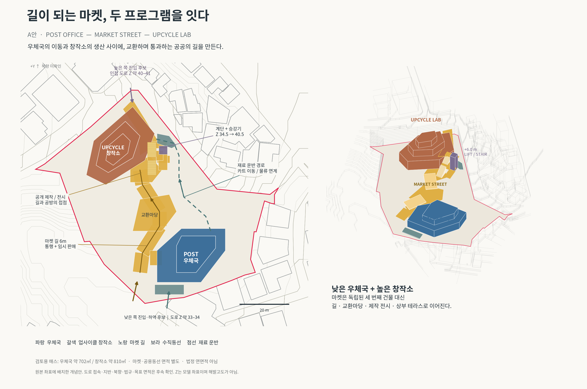
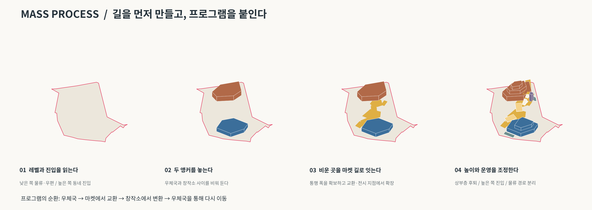
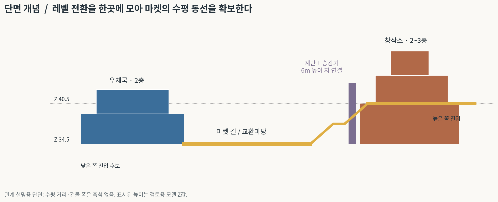

# A안 — 길이 되는 마켓

우체국과 업사이클 창작소를 마켓 길로 연결하는 매스 제안입니다. 기존 `contour.3dm`의 좌표와 mm 단위를 유지했습니다. 원본 파일은 변경하지 않았습니다.

## 파일 다운로드

- [전체 자료 ZIP](A_market_street_package.zip?raw=true)
- [기존 지형 + 제안 매스 · Rhino 8](A_market_street_context.3dm?raw=true)
- [제안 매스만 · Rhino 8](A_market_street_overlay.3dm?raw=true)
- [배치·입체도 PDF](A_proposal_board.pdf?raw=true)
- [매스 프로세스 PDF](A_mass_process.pdf?raw=true)
- [설계 설명과 검토 조건](README_제안설명.md)

GitHub에서 파일 페이지를 열었을 때는 **Download raw file** 버튼으로 내려받을 수 있습니다. ZIP에는 Rhino 파일 2개, 이미지·PDF 도면, 설계 설명이 포함되어 있습니다.

## 배치·입체도

## 매스 형성 과정

## 단면 개념

## 검토 범위

우체국 2층, 창작소 2~3층, 마켓 기본 폭 6m의 검토용 모델입니다. 실제 북향·도로 접속·목표 면적·법규·구조는 확정되지 않았습니다. 형상 유효성과 파일 재읽기를 검사했으며, Rhino 데스크톱 검토는 수행하지 않았습니다. 기존 모델의 Road Brep 2개에 있던 오류는 수정하지 않았습니다.
