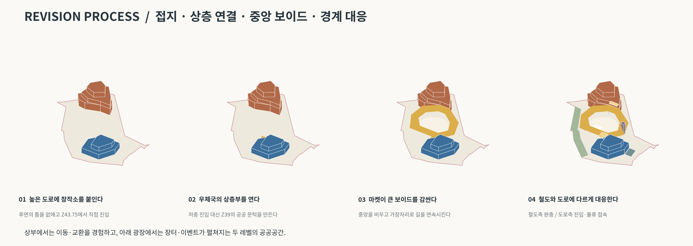
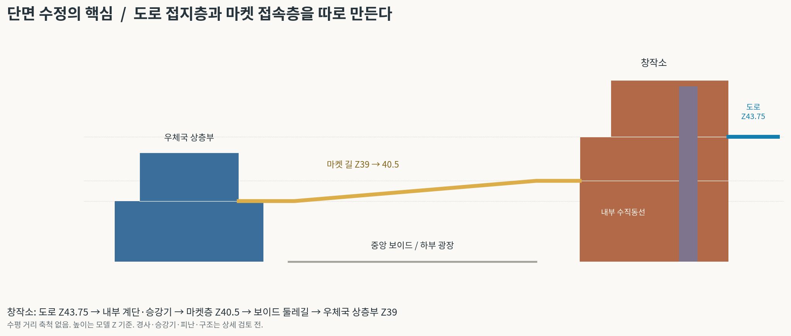

# B안 — 길을 들어 올리고, 가운데를 비우다

사용자 수정사항을 반영한 두 번째 매스 제안입니다. 프로그램의 큰 배치는 유지하면서, 창작소를 높은 도로에 붙이고 우체국 상층부와 창작소 사이의 마켓을 중앙 보이드 둘레의 길로 바꿨습니다.

## 다운로드

- [전체 자료 ZIP](B_courtyard_market_package.zip?raw=true)
- [기존 지형 + B안 매스 · Rhino 8](B_courtyard_market_context.3dm?raw=true)
- [B안 매스만 · Rhino 8](B_courtyard_market_overlay.3dm?raw=true)
- [배치·입체·단면 관계도 PDF](B_proposal_board.pdf?raw=true)
- [수정 프로세스 PDF](B_mass_process.pdf?raw=true)

GitHub 파일 페이지의 **Download raw file** 버튼으로 내려받을 수도 있습니다.

## 수정 배치·입체도

## A안에서 달라진 점

| 항목 | 수정 내용 |
|---|---|
| 주변 경계 해석 | 사용자가 표시한 **위쪽 도로 / 왼쪽 아래 철도**를 반영했습니다. A안의 아래쪽 진입·하역 가정은 폐기했습니다. |
| 창작소와 경사지 | 도로측으로 매스를 확장하고 뒤쪽 면을 대지 경계에 맞댔습니다. 모델 Z=43.75m 도로 상단과 같은 높이의 직접 진입층을 만들었습니다. |
| 마켓과 우체국 | 우체국 Z=39m 상층부에 공공 출입과 마켓 접속을 배치했습니다. 하층 Z=34.5m는 물류·포장 중심으로 설정했습니다. |
| 중앙 공간 | 가운데를 약 561㎡의 상부가 열린 보이드로 비웠습니다. 아래 광장은 장터·교환·이벤트 공간으로 사용하고 상부 마켓은 가장자리를 돕니다. |
| 마켓과 창작소 | 마켓은 창작소 Z=40.5m 층에 직접 붙습니다. 높은 도로 진입층 Z=43.75m와는 창작소 내부 계단·승강기로 연결하는 구상입니다. |
| 철도측 | 대지 안쪽에 완충 녹지 영역을 두고 철도측 진입을 없앴습니다. |
| 물류 접근 | 도면 오른쪽 위의 도로변에서 우체국 측면으로 접근하는 후보를 표시했습니다. 차량 동선 확정이나 회차 검증을 뜻하지 않습니다. |

**도로 → 창작소 접지층 → 내부 수직동선 → 상부 마켓 → 우체국 상층부**가 공공 접근의 주 관계입니다. 하부 광장은 상부 마켓의 큰 계단과 별도 승강기로 연결합니다. 두 마켓 레벨 사이를 걸으며 광장과 제작 활동을 내려다보는 구상입니다.

## 프로세스와 단면

단면도는 관계 설명용으로 수평 거리에 축척이 없습니다. 중앙 위에 마켓 바닥을 덮은 것이 아니라, 보이드 둘레의 동선을 단면에 투영한 것입니다.

## 이번 모델의 규모와 높이

| 구분 | 값과 해석 |
|---|---|
| 우체국 | 하층 Z34.5 / 상층 Z39 / 지붕 Z42.6m. 층별 매스 투영면적 합계 약 **702㎡**. |
| 창작소 | 제작층 Z34.5 / 마켓 접속층 Z40.5 / 높은 도로 접속층 Z43.75 / 지붕 Z47.95m. 합계 약 **1,114㎡**. |
| 마켓 | 우체국 쪽 Z39에서 창작소 쪽 Z40.5까지 높이가 변하는 둘레길. 둘레 데크 투영면적 약 **740㎡**. |
| 중앙 보이드 | 개구부 투영면적 약 **561㎡**. 광장으로 내려오는 계단의 평면 약 57㎡가 포함되므로 순수 행사 바닥면적과는 다릅니다. |
| 철도측 완충 | 대지 경계 안쪽으로 대략 5~7m 폭의 조경 영역을 제안했습니다. **철도 선로·시설 경계에서 재는 법정 이격거리가 아닙니다.** |

목표 면적은 아직 주어지지 않았습니다. 창작소의 접지면을 확장하면서 A안보다 매스 면적이 늘어났으므로, 이후 요구 면적을 정하면 조정해야 합니다. 모든 값은 개념 매스의 투영면적이며 법정 연면적·건축면적 산정 결과가 아닙니다.

Z는 원본 모델 좌표입니다. 해발고도와 동일하다고 가정하지 않았습니다. 도면의 위쪽은 모델 +Y이며 실제 북향은 확인되지 않았습니다.

## Rhino 파일 사용

1. `B_courtyard_market_context.3dm`을 열면 원본 지형·건물·도로와 B안이 함께 보입니다.
2. 기존 작업 파일에 제안만 가져오려면 `B_courtyard_market_overlay.3dm`을 Import합니다. **원본 좌표·mm 단위를 유지했으므로 이동·축척 변경을 하지 않습니다.**
3. `PROPOSAL_B_POST`, `LAB`, `MARKET`, `CANOPY`, `CORE`, `SERVICE`, `BUFFER`, `SITE`, `LABEL` 레이어로 구분했습니다. 모두 `PROPOSAL_B_` 접두어가 붙습니다.
4. 원본의 빨간 SITE 솔리드는 컨텍스트 파일에 보존했으며 기본 표시만 껐습니다. 실제 경계선은 `PROPOSAL_B_SITE`에 있습니다.
5. `PROPOSAL_B_ROAD`, `PROPOSAL_B_RAIL`은 사용자 표시를 해석한 방향 안내선입니다. 정밀 측량 선형으로 오인하지 않도록 기본 표시를 껐습니다.
6. 경사진 마켓 데크 8개는 닫힌 Mesh이며, 건물·바닥·계단 매스는 닫힌 Extrusion입니다. 전체가 하나로 합쳐진 시공용 솔리드는 아닙니다.

A안과 원본 `contour.3dm`은 수정하지 않았습니다.

## 확인한 사항

- 원본 좌표와 단위 보존, 원본 파일 해시 불변 확인.
- 제안 객체의 형상 유효성, Extrusion/Brep의 닫힘과 Mesh의 닫힘, 저장 후 재읽기 확인.
- 컨텍스트 파일에서 원래 227개 객체 ID 보존 확인.
- 새 형상 바닥 경계의 꼭짓점과 변 위 표본점들이 주요 SITE 경계 안에 있음을 확인.
- 창작소의 높은 진입 경계 양 끝이 원본 Road 객체의 Z43.75m 상단 변과 일치함을 좌표로 확인.
- 중앙 보이드 중심 위를 덮는 마켓 바닥이 없음을 확인.

## 다음 설계에서 남은 검토

현장 도로·보도와의 실제 접속, 출입 허가와 차량 회차, 정밀 철도 경계 및 필요한 이격거리, 소음·진동, 일조·피난·구조·옹벽·기초는 확정하지 않았습니다. 완충 녹지만으로 철도 소음이나 진동이 해결된다고 가정하지 않았습니다.

마켓 데크의 안쪽 변을 따라 계산한 경사는 최대 약 5%이지만, 삼각화한 면의 최대 기울기는 약 6%입니다. 이 값은 무장애 동선 적합 판정이 아닙니다. 실제 보행선·횡경사·평탄한 휴게참·난간·승강기 출입을 다음 평면과 단면에서 조정해야 합니다. 매스 모델에는 상세 난간과 방화·피난 구획을 설계하지 않았습니다.

Rhino 데스크톱에서의 화면 검토는 수행하지 않았습니다. 원본 Road Brep 2개의 기존 형상 오류는 그대로 보존되어 있습니다.
