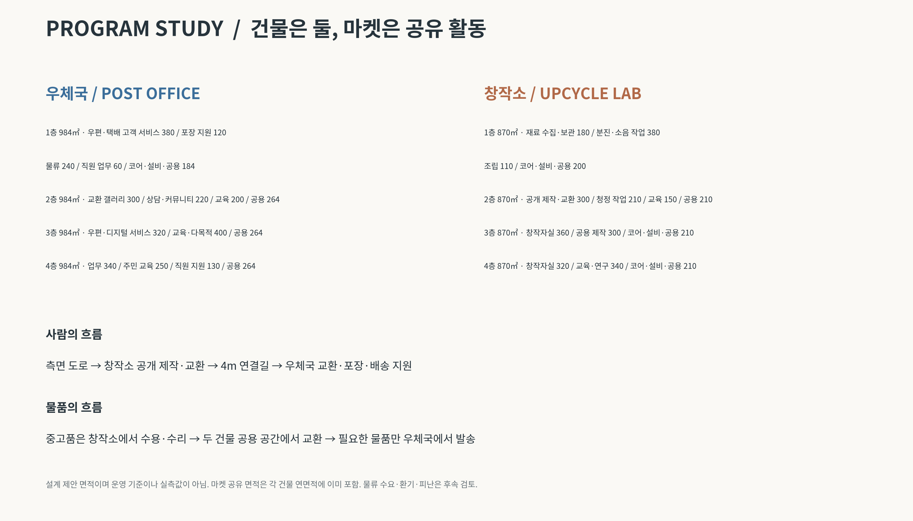

# E안 — 두 건물, 하나의 교환하는 길

[주변 포함 Rhino](E_two_buildings_context.3dm?raw=true) · [매스만 Rhino](E_two_buildings_overlay.3dm?raw=true) · [전체 ZIP](E_two_buildings_package.zip?raw=true)

## 교수 크리틱과 기존 비율 반영

사용자가 제공한 크리틱 전 계획은 우체국 2,000㎡, 창작·중고마켓 2,000㎡, 창작소 3,500㎡, 총 7,500㎡입니다. 이를 기준으로 총량과 창작소 규모를 유지하면서 우체국을 확대했습니다. 비교 기준은 직전 D안이 아니라 사용자의 프로그램 면적표입니다. 실제 기존 우체국 실측 면적은 확인되지 않았습니다.

독립 마켓 건물은 제거했습니다. 주 매스는 우체국과 창작소 두 개이며, 마켓은 각 건물의 공용 공간을 쓰는 전시·교환·판매 활동입니다.

| 건물 기준 | 크리틱 전 | E안 |
|---|---:|---:|
| 우체국 | 2,000㎡ | 3,936㎡, 공유 마켓 300㎡ 포함 |
| 창작소 | 3,500㎡ | 3,480㎡, 공유 마켓 300㎡ 포함 |
| 별도 마켓 건물 | 2,000㎡ | 없음 |
| 두 건물 실내 합계 | 7,500㎡(기존 마켓 포함) | 7,416㎡ |
| 외부 연결길·도로 문턱 | 기존 표에서 구분 불명 | 65.29㎡ |
| E안 보수적 검토 합계 | — | 7,481.29㎡ |

우체국 건물의 비중은 두 건물 실내 합계에서 53.1%, 창작소는 46.9%입니다. 다만 기존 표의 우체국에는 마켓이 별도로 분류되므로, 다음 **활동별 중복 없는 비교**가 우체국 기능의 확대를 더 정확하게 보여줍니다.

| 활동별 면적 | 기존 비율 | E안 면적 | E안 비율(7,416㎡ 기준) |
|---|---:|---:|---:|
| 우체국, 공유 마켓 제외 | 26.7% | 3,636㎡ | 49.0% |
| 창작소, 공유 마켓 제외 | 46.7% | 3,180㎡ | 42.9% |
| 두 건물에 통합된 공유 마켓 | 26.7% | 600㎡ | 8.1% |

마켓 면적을 우체국에 포함하여 이름만 바꾼 확대가 아닙니다. 우체국 고유·지원 프로그램 자체도 2,000→3,636㎡로 증가합니다. 총량은 기존 7,500㎡에 가깝게 유지하며, 창작소 건물 규모도 약 3,500㎡를 확보했습니다.

## 공간 구성 스터디

사용자의 프로그램 설명과 교수 크리틱에 근거한 기능·동선·면적 스터디입니다. 외부 사례 조사 및 우정사업 운영 기준 검증을 완료한 자료는 아닙니다. 층별 면적은 매스와 일치하지만 세부 기능의 배분은 설계 가정입니다.

### 우체국 — 주민 서비스·포장·발송을 지원하는 건물

| 층 | 계획 배분(㎡) | 합계 |
|---|---|---:|
| 1층 | 우편·택배 고객 서비스 380 / 포장·재사용 지원 120 / 분류·단기보관·발송 240 / 직원 업무 60 / 코어·설비·공용 184 | 984 |
| 2층 | 교환 갤러리 300 / 상담·커뮤니티 220 / 교육 200 / 코어·설비·공용 264 | 984 |
| 3층 | 우편·디지털 서비스 320 / 교육·다목적 400 / 코어·설비·공용 264 | 984 |
| 4층 | 업무 340 / 주민 교육 250 / 직원 지원 130 / 코어·설비·공용 264 | 984 |

우체국을 물류창고 위주로 키우지 않고 고객 접수·수령, 포장 상담, 재사용 포장 지원, 주민 서비스와 교육을 확대했습니다. 우편·디지털 서비스는 온라인 발송·주소·서식 작성 지원 등의 제안이며 운영기관의 확정 업무가 아닙니다. 금융 기능은 운영 범위 확인 전이므로 별도로 가정하지 않았습니다.

물류 240㎡는 우체국 전체의 약 6.1%입니다. 도로측 하역 후보 공간 48㎡에 인접하게 모았으며 직원용 수직동선과 연결합니다. 고객 포장 지원 120㎡와 직원 물류 240㎡는 구분됩니다. 창작소 재료 보관은 창작소가 담당하여 우체국에 모든 재료를 모으지 않습니다.

물류 면적은 지역 접수·수령과 단기 분류를 전제로 한 가정입니다. 기존 시설의 집배·차량 거점 기능을 유지할 수 있는지는 일평균 물량·직원·차량·체류시간 확인이 필요합니다. 240㎡를 검증된 최소 기준으로 보아서는 안 됩니다. 고객 동선은 2층 공유 길, 직원 물류는 도로측 하역과 전용 코어로 분리하는 방향이며 실제 실별 평면·차량 회전은 후속 검토입니다.

### 창작소 — 수용·수리·제작·공개 교육의 건물

| 층 | 계획 배분(㎡) | 합계 |
|---|---|---:|
| 1층 | 재료 수집·보관 180 / 분진·소음 작업 380 / 조립 110 / 코어·설비·공용 200 | 870 |
| 2층 | 공개 제작·교환 300 / 청정 제작 210 / 워크숍 150 / 코어·설비·공용 210 | 870 |
| 3층 | 창작자실 360 / 공용 제작 300 / 코어·설비·공용 210 | 870 |
| 4층 | 창작자실 320 / 교육·연구 340 / 코어·설비·공용 210 | 870 |

재료는 수용 가능한 종류를 확인한 뒤 보관합니다. 분진·소음 작업과 청정 제작·교육을 분리하며, 방문객은 생산 작업실을 통과하지 않고 2층 공개 제작·교환 공간을 이용합니다. 집진·환기·방화와 중량 재료 반입은 상세 설계에서 검토해야 합니다.

### 두 건물을 아우르는 마켓과 길

창작소의 수리 시연·재료 교환·전시가 우체국의 중고품 교환·포장·배송 지원으로 연결됩니다. 각각 300㎡를 평상시 라운지·전시·공용 공간으로 사용하고 마켓 행사 때 전환합니다. **4m×15m 연결길 60㎡는 통행 공간이며 상설 점포로 채우지 않습니다.** 공유 마켓 600㎡는 이미 두 건물의 연면적에 포함됩니다.

측면 도로 → 창작소 2층 공유 공간 → 수평 연결길 → 우체국 2층 공유 공간이 Z39.75에서 이어집니다. 높은 도로는 Z43.75 창작소 3층으로 직접 연결합니다. 두 건물 모두 4층이며 Z34.50 / 39.75 / 43.75 / 47.75, 지붕 Z51.75로 계획했습니다. 실내 규모를 유지하기 위해 앞선 초안보다 층수를 늘린 개념안이며 도로에서 보이는 높이·일조·높이 제한을 검토해야 합니다.

중앙 지상 마당 216㎡에는 상설 마켓 건물을 두지 않았습니다. 건물 내부 계단·승강기로 지상과 공유층을 연결하고, 피난은 연결길 하나에 의존하지 않도록 후속 평면을 구성합니다.

## 면적과 파일 검증

모델 SITE 면적 4,445.64㎡ 기준 건축 투영면적 1,919.29㎡, 검토 연면적 7,481.29㎡입니다. **건폐율 43.2% / 상한 60%, 용적률 168.3% / 상한 200%.** 도면의 기존 계획은 대지 4,500㎡를 사용하지만 이번 모델은 앞서 합의한 모델 경계 면적을 계속 사용했습니다. 법정 대지면적이 4,500㎡로 확정되면 비율을 다시 산정해야 합니다.

외부 연결길 60㎡와 문턱 5.29㎡까지 연면적에 보수적으로 포함했으며 법정 산정은 아닙니다. 마당·하역 포장·조경은 제외하고 내부 코어·공유 마켓은 중복 가산하지 않았습니다.

Rhino 8 / mm / 원본 좌표 유지. 생성 객체의 유효성·닫힌 솔리드·저장 후 재열기, 주요 대지 경계 내 배치와 철도 완충 비중첩을 확인했습니다. 원본 contour.3dm과 이전 안은 보존했으며 원본 도로 Brep 2개의 결함은 수정하지 않았습니다.

`PROPOSAL_E_POST`와 `PROPOSAL_E_LAB`가 두 주 매스입니다. `MARKET`은 연결길과 내부 조닝 표시입니다. 내부 조닝 표시는 기본 숨김 객체이며 Rhino `Show`로 볼 수 있습니다. `CORE`는 개념 코어 위치, `ROAD`는 연결 동선이며 기본 숨김 레이어입니다. 벽·문·설비·구조 상세는 포함하지 않습니다.

[배치 보드 PDF](E_proposal_board.pdf?raw=true) · [프로그램 스터디 PDF](E_program_study.pdf?raw=true)
