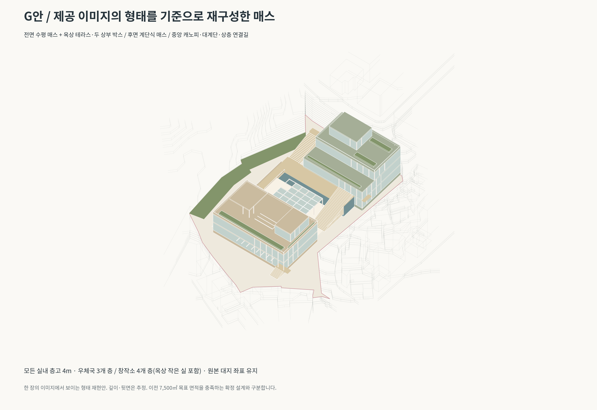

# G안 — 제공 이미지의 형태를 기준으로 재구성한 모델

[주변 포함 Rhino](G_reference_mass_context.3dm?raw=true) · [모델만 Rhino](G_reference_mass_overlay.3dm?raw=true) · [전체 ZIP](G_reference_mass_package.zip?raw=true)

F안의 계단식 박스를 재사용하지 않고, 제공된 투시도의 보이는 형태를 기준으로 새로 만들었습니다. 한 장의 투시도에는 정확한 치수·가려진 뒷면 정보가 없으므로 동일 원본의 복제는 아니며 깊이·보이지 않는 면을 추정한 재구성입니다.

## 형태 구성

- 전면 우체국: 긴 수평형 하부·상부 건물, 옥상 테라스, 양쪽의 분리된 상부 박스, 중앙 평지붕 채광창, 전면 차양.
- 후면 창작소: 넓은 하부 두 층, 뒤로 물러난 상층 바, 작은 옥상 작업실, 옥상 화단과 외부 연결계단.
- 중앙: 유리 패널과 보 격자를 가진 개방 캐노피, 광장, 넓은 계단, 두 건물의 상층부를 잇는 꺾인 보행길.
- 창호 느낌을 확인할 수 있도록 색상 구분한 닫힌 솔리드와 입면 기둥·바닥 띠를 모델링했습니다. 실제 유리 재료·상세 벽체·창호 제품 또는 시공용 모델은 아닙니다.

캐노피는 참고 이미지의 형태를 위한 지붕과 기둥이며 사방이 열린 외부 공간입니다. 별도 실내 마켓 건물로 계산하지 않았습니다. 식재는 화단 매스이며 수목·사람·가구는 제외했습니다.

## 높이·면적과 기존 안의 관계

모든 실내층의 층고는 4m입니다. 우체국은 1층 Z35.75, 2층 Z39.75, 옥상 두 실 Z43.75, 지붕 Z47.75입니다. 창작소는 Z35.75 / 39.75 / 43.75 / 47.75, 지붕 Z51.75입니다. 기단 높이 1.25m는 층고가 아니며 원본 지표 Z34.50과의 단차입니다. 측면 도로 Z39.75와 높은 도로 Z43.75 접속 높이를 유지했습니다.

**이번 파일은 이미지 형태 재현을 우선한 별도 안입니다. 이전 E·F안의 약 7,500㎡ 총량과 우체국 확대 비율을 유지한 설계안은 아닙니다.** 보이는 층수와 후퇴 형태를 적용한 실내 연면적은 우체국 1,800㎡, 창작소 2,150㎡, 합계 3,950㎡입니다. 기존 2,000㎡ 우체국 목표보다도 작으므로 이 형태로 최종 계획을 진행하려면 건물 길이·깊이 또는 층수의 재조정이 필요합니다. 확인되지 않은 지하층을 추가하여 목표 면적을 맞추지는 않았습니다.

외부 계단·데크·중앙 캐노피 전체 투영면적까지 추가한 보수적 검토 면적은 4,761.29㎡, 투영 합집합은 2,271.39㎡입니다. 모델 대지 4,445.64㎡ 기준 건폐율 검토 51.1%, 용적률 검토 107.1%입니다. 법정 산정이 아닌 형태 검토 수치입니다.

## 파일 사용과 검증

Rhino 8, mm, 원본 좌표. `context`는 주변 지형·건물 포함, `overlay`는 제안만 포함합니다. `PROPOSAL_G_*` 레이어에서 프로그램 외곽, 유리색 매스, 입면 프레임, 캐노피, 계단, 조경을 편집할 수 있습니다. 창호색 층 매스도 닫힌 솔리드이며 실제 빈 실내 공간을 만든 BIM 모델은 아닙니다. 내부 코어와 도로 안내선은 기본 숨김입니다.

새 객체 유효성·닫힌 솔리드·파일 재열기, 실내층고 4m, 주요 대지 내 배치와 철도 완충 비중첩을 확인했습니다. 원본 contour.3dm 및 이전 제안은 변경하지 않았습니다. 원본 도로 Brep 2개의 기존 결함은 보존했습니다. 구조·피난·무장애·난간·방수·차양 상세는 미검토입니다.

[모델만 보기](G_mass_only.png) · [보드 PDF](G_reference_board.pdf?raw=true)
