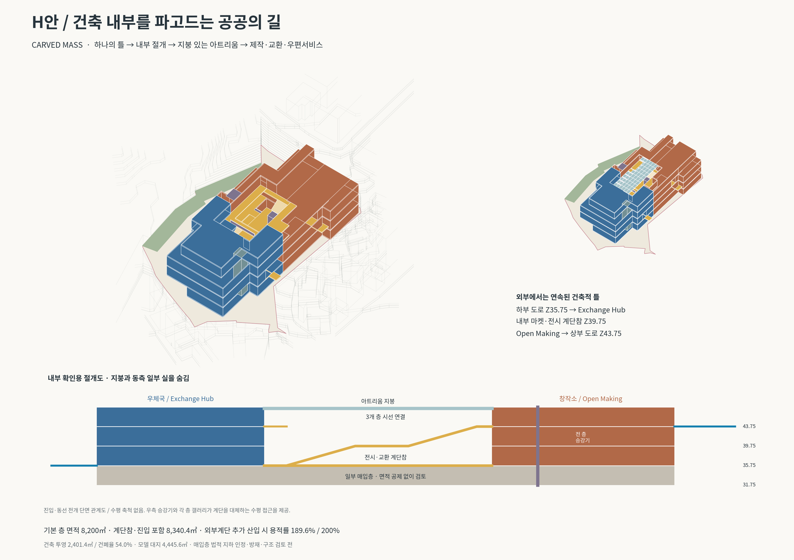
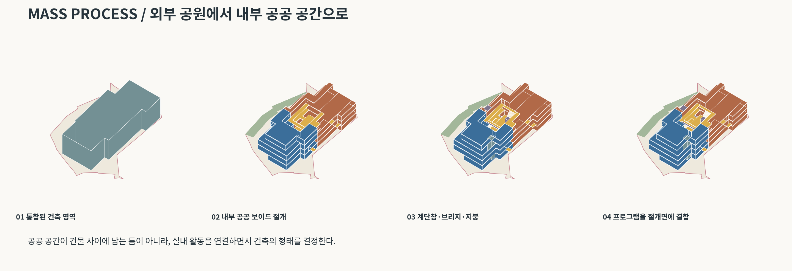
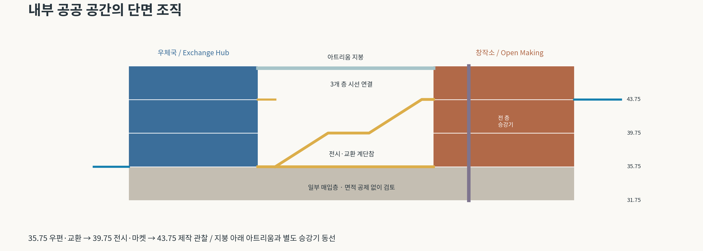

# H안 — CARVED MASS: 건축 내부를 파고드는 공공의 길

[전체 ZIP](H_carved_atrium_package.zip?raw=true) · [주변 포함 Rhino](H_carved_atrium_context.3dm?raw=true) · [제안만 Rhino](H_carved_atrium_overlay.3dm?raw=true) · **[내부 절개 Rhino](H_carved_atrium_cutaway.3dm?raw=true)**

## 이번 크리틱을 어떻게 반영했는가

사용자가 첨부한 설계 지침을 바탕으로 접근 자체를 변경했습니다. 우체국과 창작소를 먼저 분리 배치하지 않고, 연속된 건축 영역 안에서 공공 공간을 절개했습니다. 내부에 바닥판·계단참·브리지·갤러리를 만들고 그 주위에 프로그램을 남겼습니다. 외부에서는 하나의 건축적 틀로 읽히면서 하부 우체국과 상부 창작소의 역할은 구분됩니다.

1. 전체 건축 영역 설정: 주요 대지 안에 약 2,369㎡의 연속된 기본 영역을 구성.
2. 내부 절개: 12×30m 보이드를 상층 바닥에서 제거. 매스 위에 선만 그린 표현이 아니라 실제 비어 있는 공간입니다.
3. 입체 공공 공간: 지붕이 있는 아트리움, 두 구간의 내부 공공 계단, 전시 계단참과 층별 브리지를 추가.
4. 프로그램 결합: 우체국의 로비·Exchange Hub와 창작소의 Open Making·관람 갤러리를 절개면에 배치. 마켓은 별도 건물이 아니라 공공 홀과 계단참에서 일어나는 활동입니다.

## 단면과 진입 — 실제 모델 레벨

| 위치 | 모델 Z | 개념 역할 |
|---|---:|---|
| 일부 매입되는 하부층 | 31.75 | 제작 지원·업무·보관 등, 법적 지하층 여부 미확정 |
| 낮은 도로 진입 / 주 공공층 | 35.75 | 우체국 로비·우편/금융 서비스 계획 영역·Exchange Hub·중심 홀 |
| 중간 도로 진입 / 2층 공유층 | 39.75 | 전시·마켓 계단참·관람 갤러리·브리지 |
| 높은 도로 진입 / 상부 공유층 | 43.75 | Making Window·Open Making·제작 관찰 |
| 주요 실 지붕 | 47.75 | 아트리움 채광 지붕은 Z47.50~47.65 |

모든 층간 높이는 4m입니다. 상부·하부 진입의 실제 높이 차이는 8m입니다. 하부 진입은 철도측이 아니라 **동측 도로가 낮아지는 구간**에 있습니다. 낮은 도로 Z35.75와 높은 도로 Z43.75의 접속점 끝단은 원본 Road 선형에서 같은 높이에 위치함을 확인했습니다. 접속 도로 폭, 출입문, 도로 경사·보도 상세는 별도 검토입니다.

내부 동선은 다음처럼 이어집니다.

높은 도로 → Making Window → Open Making 갤러리 → 내부 계단 → 전시·교환 계단참 → 내부 계단 → 중심 홀·Exchange Hub → 우체국 공공 로비 → 낮은 도로.

계단과 별도로 전 층 공용 승강기 및 그 앞의 넓어진 수평 갤러리를 배치했습니다. 승강기는 계단참과 가까우며, 계단을 이용하지 않고 각 활동 공간으로 접근하는 구성입니다. 공용 계단 코어와 우체국 직원용 코어도 분리했습니다. 코어는 위치·체적 검토용이며 승강기 출입문과 피난계단 상세를 구현한 것은 아닙니다.

단면 이미지는 진입과 동선을 펼친 관계도입니다. 모든 실·도로가 하나의 직선 절단면 위에 있다는 뜻은 아닙니다. 실제 3D 위치는 Rhino 파일에서 확인할 수 있습니다.

## 아트리움이 외부 공원과 다른 점

- 실내 작업 영역이 공공 공간의 양쪽과 끝을 둘러싸며, 그 내부 바닥에서 보이드를 절개했습니다.
- 채광 지붕 아래에서 3개 층이 시각적으로 연결됩니다. 도로 진입 쪽은 일부 개방된 반외부 구간으로 계획했습니다.
- 중간 계단참에 전시·마켓·휴식 활동이 결합하고, 브리지와 갤러리가 제작 과정을 보는 위치가 됩니다.
- 우체국의 모든 업무를 공개하지 않고 아트리움에는 로비·교환 지원만 접하도록 합니다. 전문 작업실과 직원 업무는 안쪽에 남깁니다.

실내 판매·관람 공간과 작업실의 출입구, 방음·집진·화재 구획은 후속 평면 설계 대상입니다. ECC는 사용자가 제시한 공간 관계의 참고이며, 이 파일은 ECC의 형태를 복제한 안이나 외부 사례 조사 완료 자료가 아닙니다.

## 규모와 산정 방식

| 모델 레벨 | 기본 바닥 면적 |
|---|---:|
| Z31.75 | 2,189㎡ |
| Z35.75 | 2,369㎡ |
| Z39.75 | 2,045㎡ |
| Z43.75 | 1,597㎡ |
| 합계 | **8,200㎡** |

추가 계단참 108㎡와 도로 진입 문턱 약 32.43㎡를 포함한 바닥 면적 합계는 **8,340.43㎡**입니다. 내부 계단의 수평 투영 90㎡도 별도로 추가한 보수적 검토값은 **8,430.43㎡**입니다. 계단·문턱의 최종 법정 산정과는 구분합니다. 브리지·계단참이 기존 바닥과 겹치는 부분은 평면 합집합으로 중복을 제거했습니다.

기본 바닥 중 우체국 실영역은 2,976㎡, 창작소 실영역은 4,035㎡, 공공 홀·갤러리는 1,189㎡입니다. 추가 계단참과 진입 공간은 공유 공공 영역입니다. 이 구분은 실측 전용면적이 아닌 매스 조닝이며, 공용 코어 일부가 실영역에 포함되어 있습니다. 우체국 물류 위치는 240㎡의 숨김 조닝 객체로 표시했으며 면적을 추가 가산하지 않았습니다. 우편·금융 서비스 및 물류 운영 규모는 운영기관과 검토해야 합니다.

모델 대지면적 **4,445.64㎡** 기준, 아트리움 지붕과 돌출 진입부를 포함한 건축 투영 합집합 **2,401.43㎡**, 건폐율 **54.0%**입니다. 지붕 아래 보이드를 외부 공지로 빼지 않았습니다. 보수적 연면적 기준 용적률은 **189.6%**로 200% 이내입니다. 사용자가 제시한 약 4,500㎡는 개략 기준이며 실제 지적 면적이 확정되면 재산정해야 합니다.

Z31.75층은 원본 주요 지표 Z34.50보다 낮게 들어갑니다. **법적 지하층으로 인정된다는 가정 없이 전 면적을 용적률에 포함**했습니다. 굴착·옹벽·평균 지표면·방수·채광·환기·피난과 철도 인접 공사 조건은 검토 전입니다. 약 8,200㎡를 담는 단면 스터디이지 인허가 적합성 확정안은 아닙니다.

[층별 면적표 CSV](H_area_schedule.csv?raw=true)

## Rhino 사용법과 검증

- `context`: 주변 지형·건물을 포함한 통합 매스. 원본 SITE 솔리드는 내부를 가리지 않도록 숨겼습니다.
- `overlay`: 제안 형상만, 원본과 동일 좌표.
- **`cutaway`: 지붕과 동측 일부 실을 숨겨 내부 아트리움·계단·갤러리를 확인하는 파일.** 숨김 객체를 다시 표시하면 복원됩니다.
- Rhino 8 / mm. `POST`, `LAB`, `MARKET`, `CORE`, `ROOF` 레이어로 구분합니다. 실영역은 닫힌 솔리드, 공공 영역은 실제 바닥판과 비어 있는 공간으로 모델링했습니다.
- 새 객체의 유효성·닫힌 솔리드, 저장 후 재열기, 대지 내 배치와 철도 완충 비중첩을 확인했습니다. 원본 파일과 이전 제안은 보존했습니다. 원본 도로 Brep 2개의 기존 결함은 수정하지 않았습니다.

아트리움 방재·제연·구조·승강기 규격·난간·실별 문·방화 구획은 상세 설계 전입니다. 외부 형태보다 공공 공간의 실제 단면 관계를 검토하기 위한 모델입니다.

[제안 보드 PDF](H_proposal_board.pdf?raw=true) · [단면 스터디 PDF](H_section_study.pdf?raw=true) · [매스 프로세스 PDF](H_mass_process.pdf?raw=true)
