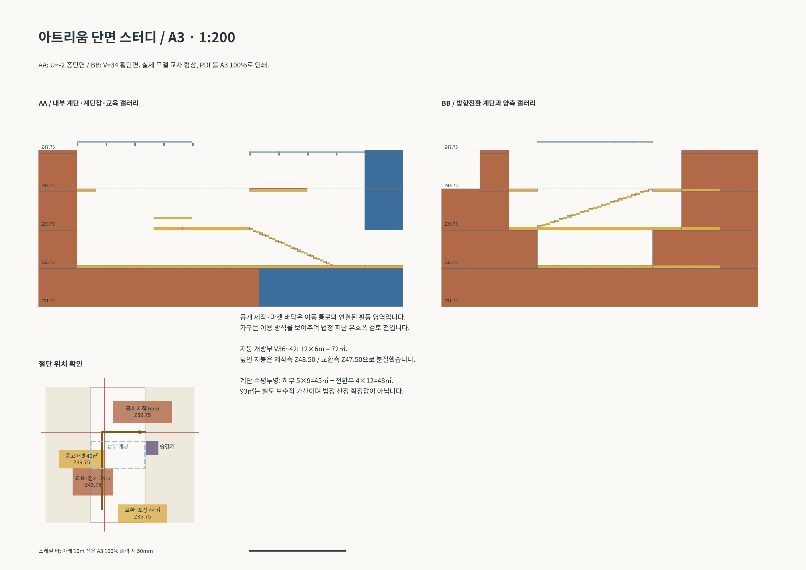
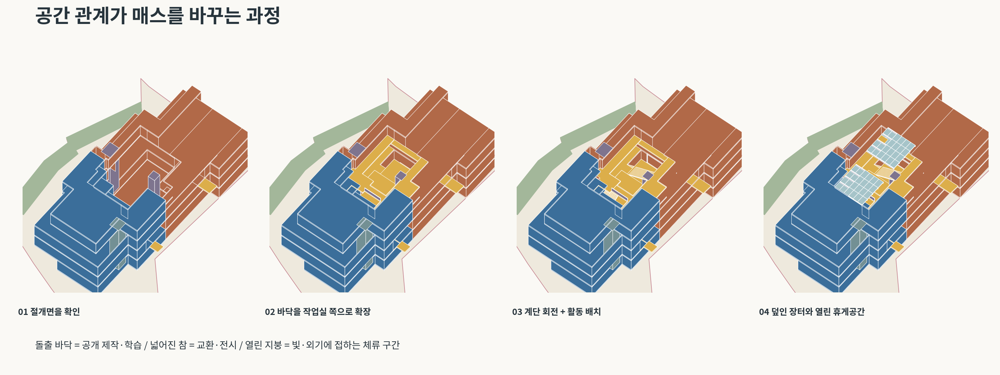

# I안 — 계단참이 제작·교환 공간으로 넓어지는 아트리움

[전체 ZIP](I_program_atrium_package.zip?raw=true) · [주변 포함 Rhino](I_program_atrium_context.3dm?raw=true) · **[내부 절개 Rhino](I_program_atrium_cutaway.3dm?raw=true)** · [모델만 Rhino](I_program_atrium_overlay.3dm?raw=true)

## PDF 변경사항 반영

사용자가 첨부한 `프로그램 조닝 계획.pdf`의 설계 검토 내용을 반영했습니다. H안의 외곽과 도로 접속 레벨은 유지하고 내부 아트리움의 프로그램 경계·계단·지붕을 수정했습니다. PDF의 가상 단면을 치수 근거로 간주하지 않고 실제 모델에서 공간을 구성했습니다.

| PDF의 지적 | 모델에 반영한 변경 |
|---|---|
| 계단에서 프로그램을 바라보기만 함 | 작업실·마켓 바닥을 계단참까지 연장하고 작업대·판매대·포장대를 배치 |
| 한 방향으로 오르는 계단 | 중간층에서 상부 계단을 90° 전환, 횡단하여 동측 상부 갤러리로 도착 |
| 양측 프로그램 경계가 평평함 | 공개 제작 바닥과 교육·전시 바닥이 보이드로 돌출되도록 변경 |
| 마켓의 실제 점유가 약함 | 중고 전시·판매, 공개 제작, 교환·포장 활동 영역을 서로 다른 참에 명시 |
| 얇고 균일한 아트리움 덮개 | 72㎡ 개방부와 높이가 다른 두 지붕 구간으로 분절 |
| 면적 추가 근거 불명확 | 기본 면적·추가참·진입부·계단 투영을 분리한 CSV와 설명 제공 |
| 단면 공간 확인 필요 | 모델에서 직접 절단한 AA·BB 단면을 A3 1:200 PDF로 제공 |

## 계단참에서 실제로 들어가는 공간

| 활동 | 모델 레벨 | 활동 영역 | 연결 방식 |
|---|---:|---:|---|
| Open Making / 공개 제작 | Z39.75 | 65㎡ | 브리지 북측에서 창작소 바닥이 아트리움 안으로 연장, 작업대 3개와 열린 진입면 |
| 중고마켓·전시 | Z39.75 | 40㎡ | 같은 레벨의 서측 참·갤러리와 일체화, 전시·판매대 배치 |
| 교육·전시 갤러리 | Z43.75 | 54㎡ | 상층 브리지가 서측 프로그램과 겹치며 넓어짐 |
| Exchange Hub / 교환·포장 | Z35.75 | 44㎡ | 낮은 도로 진입 로비에서 중심 홀로 이어지는 바닥에 포장대 배치 |

이 면적은 건물에 추가로 더하는 독립 점포 면적이 아니라 공유 바닥 안의 활동 영역입니다. 일반 실영역 솔리드를 해당 위치에서 제거해 실제로 열린 바닥을 만들었습니다. 활동 영역에는 작업대와 가변 판매대를 배치했고, 주변 갤러리를 통해 다시 아트리움 동선으로 나올 수 있습니다. 실제 문·방화 구획·집진·환기·운영 경계는 다음 평면 설계 단계에서 검토해야 합니다.

하부 계단은 5m 폭·9m 수평 길이, 상부 방향전환 계단은 4m 폭·12m 수평 길이입니다. 모두 4m 단차를 27개 단으로 연결합니다. 이 치수는 개념 스터디이며 최종 난간·휴식참·피난 기준을 검증한 시공 상세가 아닙니다. 공용 승강기와 그 앞의 넓어진 갤러리는 유지했습니다. 계단이 아닌 수평 진입과 승강기를 이용해 프로그램에 접근하는 구성이며, 모든 신규 활동 영역에 해당 층의 바닥이 연결됩니다.

## 부분 개방 지붕

기존 12×30m, 360㎡ 아트리움 지붕 가운데 12×6m인 **72㎡**를 열었습니다. 덮인 부분은 **288㎡**입니다. 제작측 지붕은 Z48.50, 교환측은 Z47.50으로 높이를 달리했습니다. 중앙 열린 구간은 빛·외기와 접하는 체류 구간, 덮인 구간은 전시·제작 관찰·교환 공간으로 구분합니다. 개방부 배수·방수·우천 운영과 아트리움 제연은 검토 전입니다.

## 단면과 프로세스

**[A3 1:200 단면 PDF](I_sections_A3_1-200.pdf?raw=true)**는 실제 모델의 U=-2 종단면과 V=34 횡단면 교차 형상입니다. 축척은 PDF를 A3·100% 크기로 출력할 때 적용되며, 페이지 맞춤 출력이나 PNG 화면 크기는 축척 기준이 아닙니다. 10m 스케일 바는 50mm입니다. 단면은 절단된 매스와 바닥의 관계를 보여주며 배근·설비·방화 상세는 아닙니다.

프로세스 도면은 절개면 확인 → 프로그램 바닥 확장 → 계단 회전·활동 배치 → 부분 지붕을 순서대로 표시합니다. 최종 파일은 네 단계의 요소를 모두 포함합니다.

## 면적 근거 — 법정 산정과 구분

모델 대지는 기존과 동일한 **4,445.64㎡**입니다. 실제 지적 경계 확정 전입니다. Z31.75의 매입층도 전 면적을 포함했으며 법적 지하층 공제를 가정하지 않았습니다.

| 항목 | 면적 |
|---|---:|
| Z31.75 기본 바닥 | 2,189㎡ |
| Z35.75 기본 바닥 | 2,369㎡ |
| Z39.75 기본 바닥 | 2,080㎡ |
| Z43.75 기본 바닥 | 1,612㎡ |
| 기본 바닥 합계 | **8,250㎡** |
| 추가 계단참(중복 제거) | 108㎡ |
| 도로 진입 문턱 | 32.425㎡ |
| 바닥 합계 | **8,390.425㎡ → 188.73%** |
| 하부 계단 수평투영 | 5×9 = 45㎡ |
| 방향전환 계단 수평투영 | 4×12 = 48㎡ |
| 계단을 별도 가산한 보수적 합계 | **8,483.425㎡ → 190.83%** |

계단 93㎡는 바닥 합계와 구분한 보수적 가산입니다. 계단실·보이드·지붕·문턱의 법정 산정 기준을 적용한 확정값으로 보아서는 안 됩니다. 프로그램 바닥의 겹침은 층별 합집합으로 제거했습니다. 작업대·가구·활동영역 마감은 면적에 다시 더하지 않았습니다.

H안의 계단 가산분은 **90㎡ = 5×9 + 5×9**였습니다. PDF에서 추정한 약 88.5㎡는 반올림된 비율에서 역산한 값과 차이가 있습니다. H안의 실제 수치 8,430.425÷4,445.638×100은 약 189.63%이며, 이번 수정안은 상부 계단의 방향과 폭·길이를 바꾸어 계단 투영이 93㎡가 되었습니다.

건축 투영 합집합은 **2,401.425㎡ / 54.02%**로 유지됩니다. 지붕 일부 개방만으로 아래 바닥의 건축 투영을 빼지 않았습니다. 수치상 제시 상한 60%/200% 이내지만 법적 적합성은 확정하지 않았습니다.

[층별 조닝 면적 CSV](I_area_schedule.csv?raw=true) · [추가 면적 산출 CSV](I_area_audit.csv?raw=true)

## 레이어와 파일

요청대로 모든 새 모델에서 `Proposal_G_`, `PROPOSAL_H_` 등 **Proposal 접두사를 제거**했습니다. 신규 레이어는 `우체국`, `창작소`, `공공동선_마켓`, `수직동선_구조`, `물류_지원`, `아트리움_지붕`, `조경_완충`, `진입동선`, `대지경계`, `공간이름`, `차양`, `철도방향`입니다. 원본 주변 지형·건물 레이어는 보존했습니다.

Rhino 8 / mm / 원본 좌표입니다. `context`는 주변 포함, `overlay`는 제안만, `cutaway`는 지붕과 동측 일부 실을 숨긴 내부 확인용입니다. 절개 파일의 숨김 객체는 다시 표시할 수 있습니다. 공간 이름은 기본 숨김 레이어로 필요할 때 켤 수 있습니다.

새 객체의 유효성·닫힌 솔리드, 파일 재열기, 대지 내 배치와 철도 완충 비중첩 및 신규 레이어 접두사 제거를 확인했습니다. 원본 contour.3dm과 H안을 포함한 기존 제안은 변경하지 않았습니다. 원본 도로 Brep 2개의 기존 결함은 보존했습니다.

[제안 보드 PDF](I_proposal_board.pdf?raw=true) · [프로세스 PDF](I_mass_process.pdf?raw=true)
