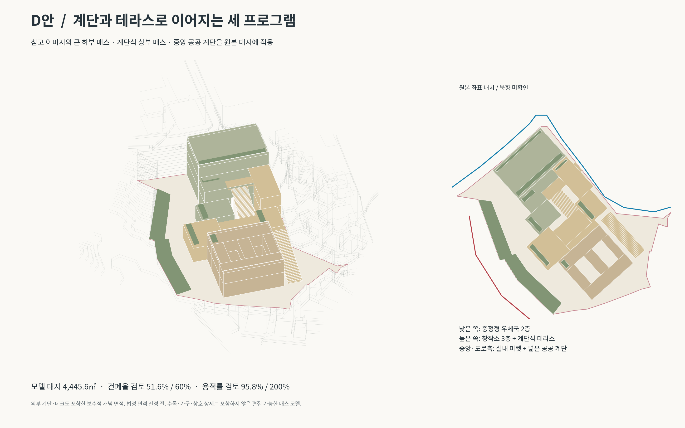
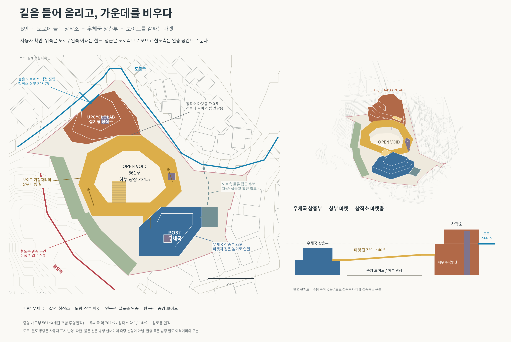

# 매스 제안 자료

## 최신 이미지 참고안: D — 계단과 테라스로 이어지는 매스

[D안 설명·미리보기](D-terraced-market/README.md) · [Rhino 파일](D-terraced-market/D_terraced_market_context.3dm?raw=true) · [전체 ZIP](D-terraced-market/D_terraced_market_package.zip?raw=true)

두 중정을 가진 하부 우체국, 계단식 창작소와 실내 마켓, 넓은 공공 계단을 원본 대지에 맞춘 제안입니다.

## 이전 수정안: B — 길을 들어 올리고, 가운데를 비우다

[**B안 도면·설계 설명·다운로드**](B-courtyard-market/README.md)

- 창작소를 높은 도로에 직접 접지
- 우체국 상층부와 연결되는 상부 마켓
- 중앙 561㎡ 보이드를 감싸는 길
- 사용자 확인에 따라 위쪽 도로 접근 / 왼쪽 아래 철도측 완충으로 수정

[전체 ZIP](B-courtyard-market/B_courtyard_market_package.zip?raw=true) · [Rhino 모델](B-courtyard-market/B_courtyard_market_context.3dm?raw=true)

## 이전 안

[A안 — 길이 되는 마켓](A-market-street/README.md)

A안은 비교용으로 보존했습니다. A안의 아래쪽 진입·하역 가정은 사용자 확인 후 B안에서 수정했습니다.
