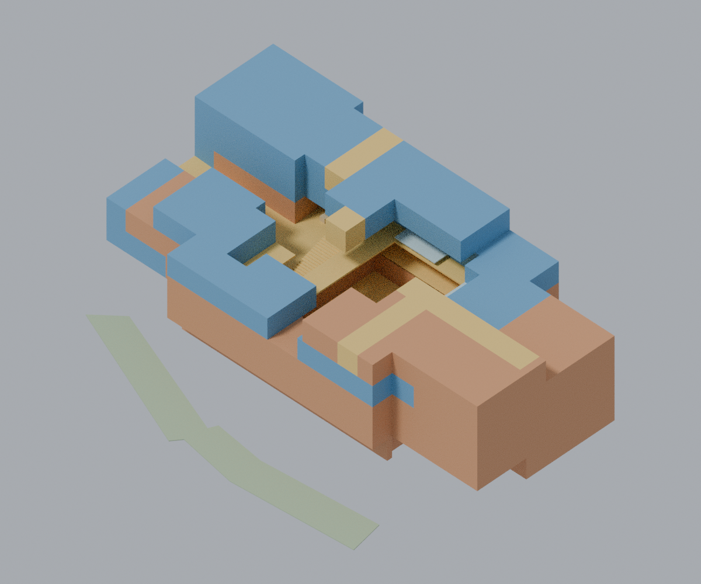
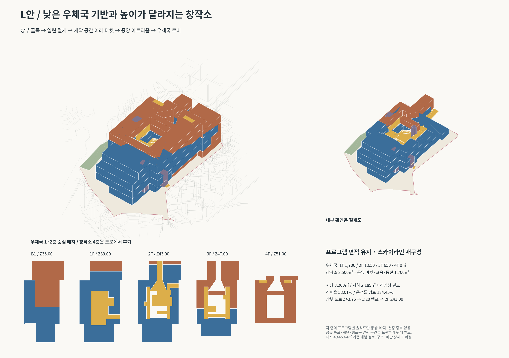
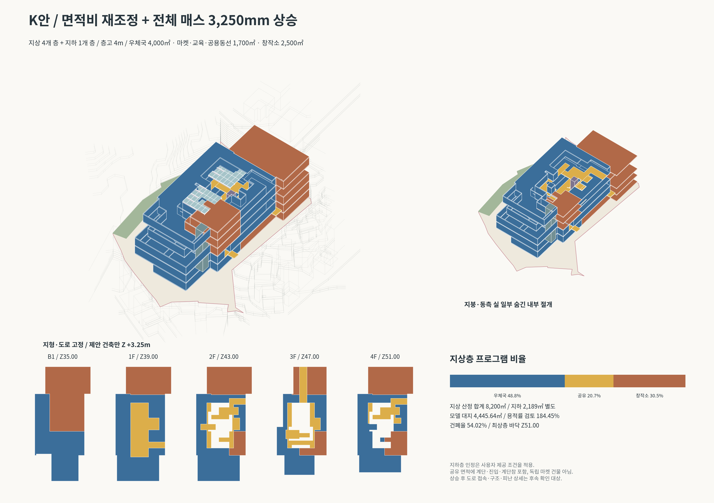
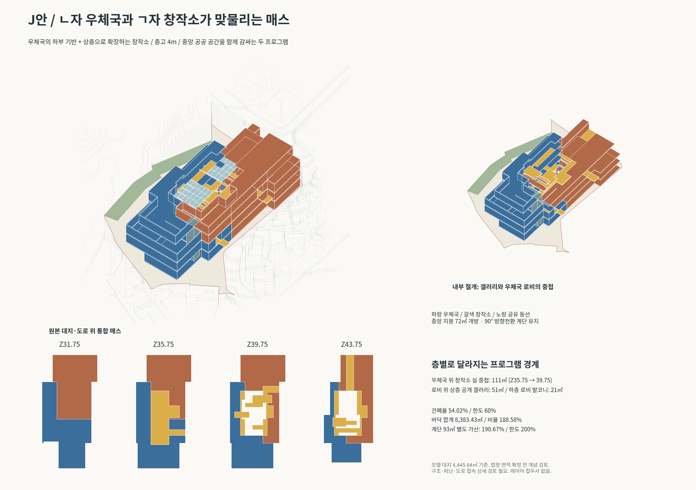
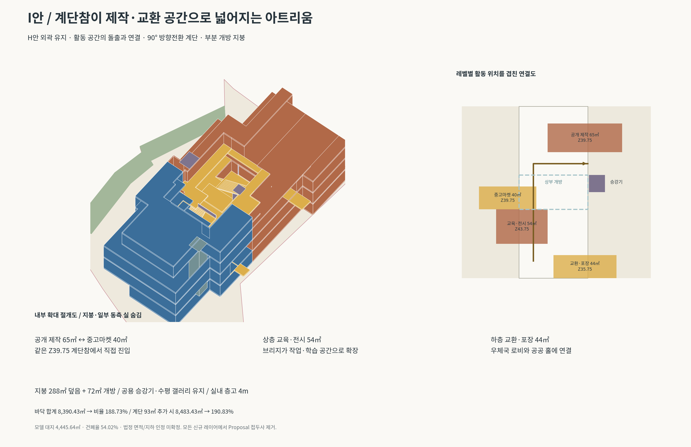
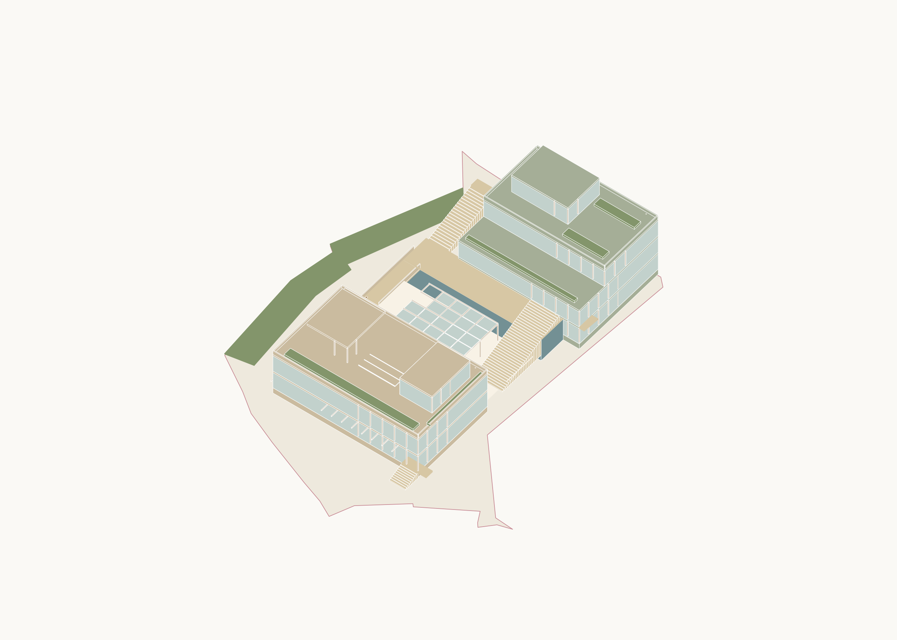
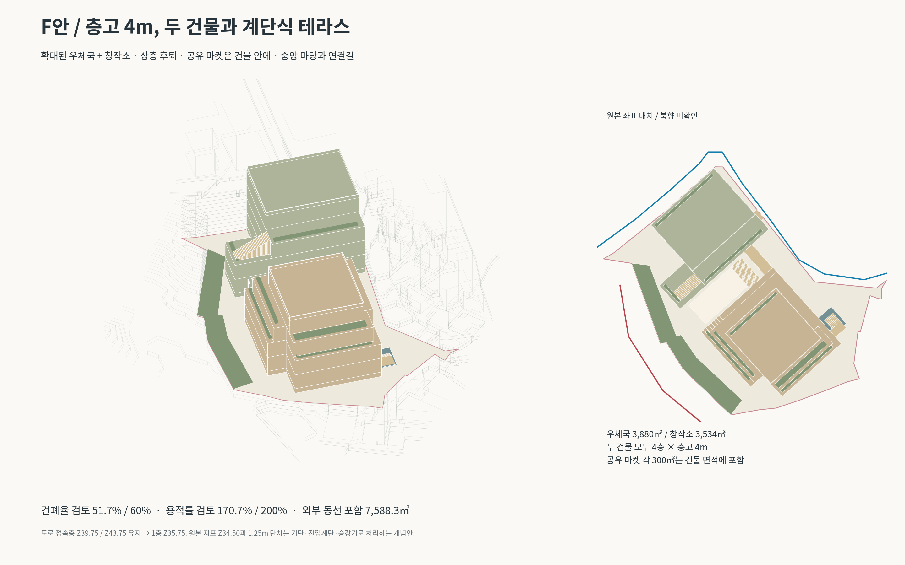
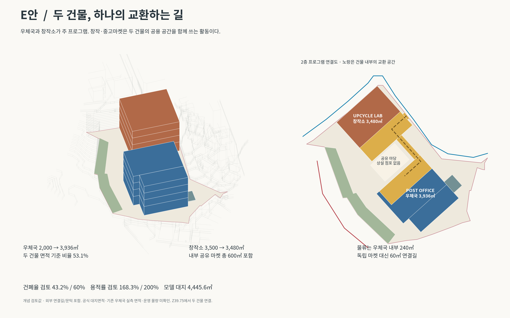

# 매스 제안 자료

## 최신 수정안: O — 창작소 내부를 관통하는 공공 가로

[Rhino 매스 파일](O-internal-creative-street/O_internal_creative_street.3dm?raw=true)

창작소 프로그램 사이로 3m 폭의 경사길이 내려가며 중앙 반외부 홀, Exchange Hub와 우체국 로비로 연결됩니다. 상층 프로그램이 진입과 길을 덮고 중앙 갤러리를 확장했습니다. 기존 도로 높이와 지상 8,200㎡ 프로그램 총량 유지, 코어 제외. 사용자 요청에 따라 매스 파일만 제공합니다.

## 이전 수정안: N — 철도·도로 측 높이 방향 조정

[설명·면적표](N-opposing-heights/README.md) · [Rhino 통합 모델](N-opposing-heights/N_public_street_context.3dm?raw=true) · [전체 ZIP](N-opposing-heights/N_mass_package.zip?raw=true)

코어 삭제. 상·하부 도로 기준 높이에 진입부 접속. 철도 측은 아래쪽, 도로 측은 위쪽으로 높아지는 매스. 층고 4m와 지상 프로그램 8,200㎡ 유지. 우체국 갈색 / 창작소 파랑.

## 이전 수정안: L — 낮은 우체국 기반과 도로에서 시작하는 절개

[L안 설명·면적표](L-terrain-atrium/README.md) · [Rhino 통합 모델](L-terrain-atrium/L_terrain_atrium_context.3dm?raw=true) · [전체 ZIP](L-terrain-atrium/L_terrain_atrium_package.zip?raw=true)

새 PDF 반영: 우체국 83.75%를 1·2층으로 이동, 4층 우체국 제거, 창작소 최상층 후퇴, 상부 도로부터 중앙 아트리움까지 절개. 지상 8,200㎡ 유지, 건폐율 58.01%로 재계산. 바닥·천장 중복 없이 층별 프로그램 솔리드만 생성.

## 이전 수정안: K — 지상 8,200㎡ 비율 수정 + Z 3,250mm 상승

[K안 설명·면적 기준](K-rebalanced/README.md) · [Rhino 통합 모델](K-rebalanced/K_rebalanced_context.3dm?raw=true) · [전체 ZIP](K-rebalanced/K_rebalanced_package.zip?raw=true)

지상 우체국 4,000㎡ / 공유 마켓·교육·동선 1,700㎡ / 창작소 2,500㎡. 지하 2,189㎡ 별도. 층고 4m의 상부층 추가 및 제안 건축 전체 3,250mm 상승. 원본 지형·도로 고정, 상승 후 도로 접속 상세 재검토 필요.

## 이전 수정안: J — ㄴ자 우체국과 ㄱ자 창작소의 맞물림

[J안 변경사항·도면](J-interlocking/README.md) · [Rhino 통합 모델](J-interlocking/J_interlocking_context.3dm?raw=true) · [내부 절개 모델](J-interlocking/J_interlocking_cutaway.3dm?raw=true) · [전체 ZIP](J-interlocking/J_interlocking_package.zip?raw=true)

새 PDF 반영: 우체국 서측 날개 확장, 창작소 상층이 우체국 위로 확장, 중앙 로비 위 횡단 갤러리. 층고 4m, 건폐율 54.02%, 계단 별도 가산 면적비 190.67%. 신규 레이어 접두사 없음.

## 이전 수정안: I — 프로그램이 침투하는 아트리움

[I안 변경사항·도면](I-program-atrium/README.md) · [Rhino 모델](I-program-atrium/I_program_atrium_context.3dm?raw=true) · [내부 절개 모델](I-program-atrium/I_program_atrium_cutaway.3dm?raw=true) · [전체 ZIP](I-program-atrium/I_program_atrium_package.zip?raw=true)

첨부 PDF 반영: 공개 제작·마켓·교육·교환 바닥을 계단참에 연결하고 계단을 90° 전환했습니다. 지붕 72㎡ 개방, A3 1:200 실제 절단면, 면적 가산 근거 포함. 신규 레이어의 Proposal 접두사를 제거했습니다.

## 이전 크리틱 반영안: H — 건축 내부를 파고드는 공공의 길

[H안 설명·도면](H-carved-atrium/README.md) · [Rhino 통합 모델](H-carved-atrium/H_carved_atrium_context.3dm?raw=true) · [내부 절개 모델](H-carved-atrium/H_carved_atrium_cutaway.3dm?raw=true) · [전체 ZIP](H-carved-atrium/H_carved_atrium_package.zip?raw=true)

통합 매스 내부에 지붕 있는 아트리움을 절개하고 내부 계단·브리지·갤러리에 창작·교환·우편서비스를 결합했습니다. 기본 층 면적 8,200㎡, 추가 계단참·진입부 포함 약 8,340㎡. 층고 4m, 매입층 면적 공제 없음.

## 이전 이미지 재현안: G

[G안 설명·미리보기](G-reference-mass/README.md) · [Rhino 파일](G-reference-mass/G_reference_mass_context.3dm?raw=true) · [전체 ZIP](G-reference-mass/G_reference_mass_package.zip?raw=true)

제공 이미지의 전면 수평 매스·옥상 두 박스·후면 테라스·중앙 캐노피·대계단을 재구성했습니다. 층고 4m. 이미지 형태를 우선한 별도 안으로 이전 약 7,500㎡ 목표 면적과 구분됩니다.

## 면적 계획 유지안: F — 층고 4m와 계단식 테라스

[F안 설명·미리보기](F-4m-terraced/README.md) · [Rhino 파일](F-4m-terraced/F_4m_terraced_context.3dm?raw=true) · [전체 ZIP](F-4m-terraced/F_4m_terraced_package.zip?raw=true)

우체국·창작소 두 주 매스, 모든 층고 4m, 상층 후퇴와 테라스·중앙 계단을 반영했습니다.

## 이전 수정안: E — 두 건물, 하나의 교환하는 길

[E안 설명·프로그램 스터디](E-two-buildings/README.md) · [Rhino 파일](E-two-buildings/E_two_buildings_context.3dm?raw=true) · [전체 ZIP](E-two-buildings/E_two_buildings_package.zip?raw=true)

교수 크리틱 반영: 우체국과 창작소 두 주 매스, 확대된 우체국, 두 건물 내부로 통합한 공유 마켓, 작은 물류 구역.

## 이전 이미지 참고안: D — 계단과 테라스로 이어지는 매스

[D안 설명·미리보기](D-terraced-market/README.md) · [Rhino 파일](D-terraced-market/D_terraced_market_context.3dm?raw=true) · [전체 ZIP](D-terraced-market/D_terraced_market_package.zip?raw=true)

두 중정을 가진 하부 우체국, 계단식 창작소와 실내 마켓, 넓은 공공 계단을 원본 대지에 맞춘 제안입니다.

## 이전 수정안: B — 길을 들어 올리고, 가운데를 비우다

[**B안 도면·설계 설명·다운로드**](B-courtyard-market/README.md)

- 창작소를 높은 도로에 직접 접지
- 우체국 상층부와 연결되는 상부 마켓
- 중앙 561㎡ 보이드를 감싸는 길
- 사용자 확인에 따라 위쪽 도로 접근 / 왼쪽 아래 철도측 완충으로 수정

[전체 ZIP](B-courtyard-market/B_courtyard_market_package.zip?raw=true) · [Rhino 모델](B-courtyard-market/B_courtyard_market_context.3dm?raw=true)

## 이전 안

[A안 — 길이 되는 마켓](A-market-street/README.md)

A안은 비교용으로 보존했습니다. A안의 아래쪽 진입·하역 가정은 사용자 확인 후 B안에서 수정했습니다.
